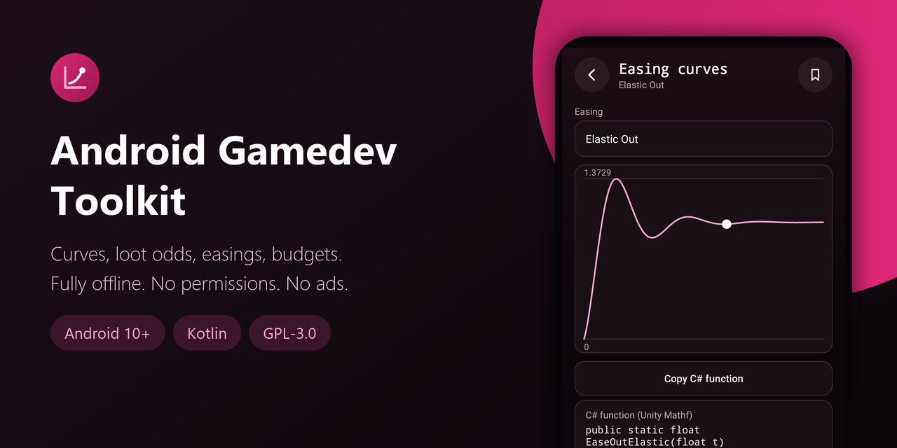
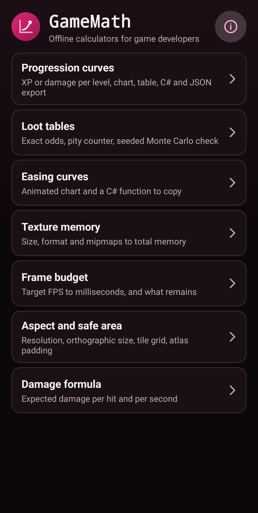
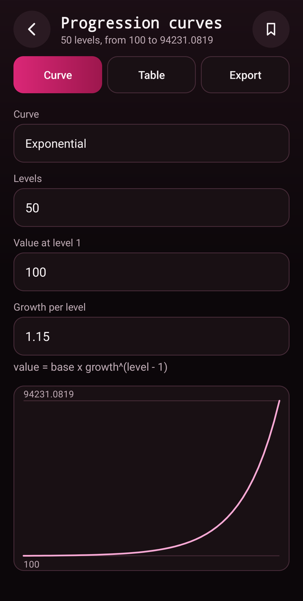
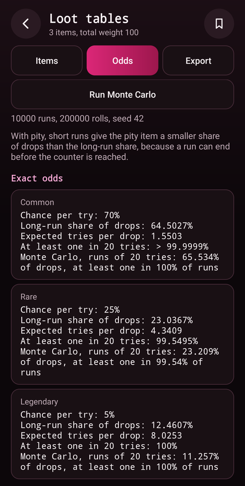
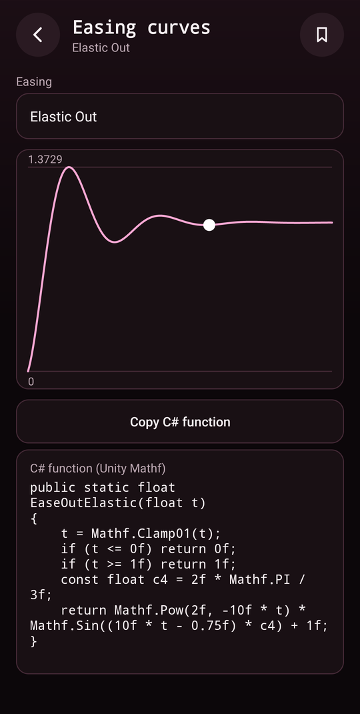
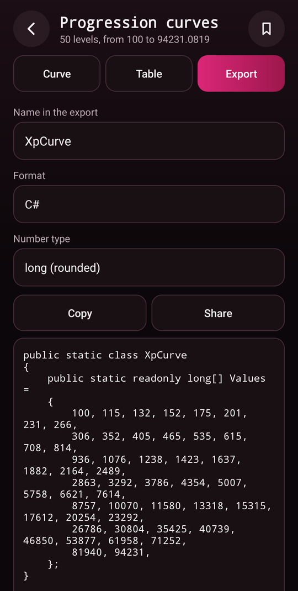
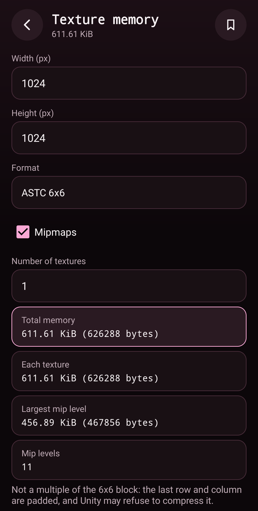
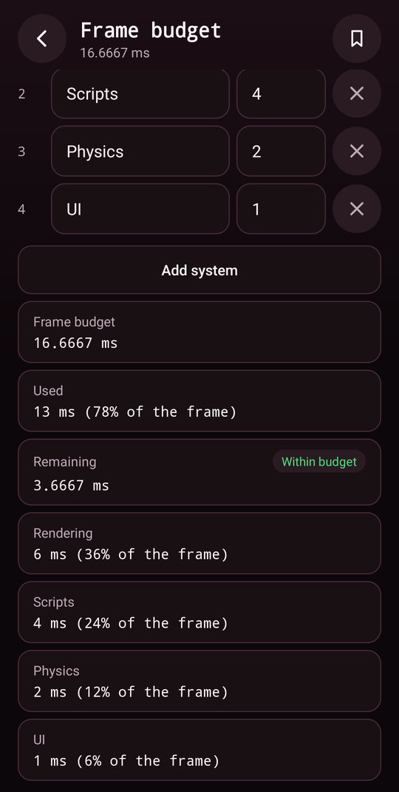
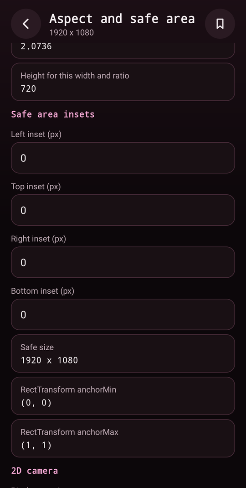

<div align="center">



# Android Gamedev Toolkit

**Offline design and tech calculators for game developers: progression curves, loot odds with pity and a seeded Monte Carlo check, easing curves, texture memory, frame budget, screen and tile maths, and damage formulas. C# and JSON export. No permissions, no ads, no analytics.**

[](LICENSE)
[](#requirements)
[](https://kotlinlang.org)
[](app/build.gradle.kts)
[](app/src/main/AndroidManifest.xml)
[](https://github.com/Nekuzaky/android-gamedev-toolkit/stargazers)

</div>

Android Gamedev Toolkit ships an app called **GameMath**. It is a set of calculators for people who build games in C# (Unity) or make small games, with the numbers worked out on the phone and nothing sent anywhere.

GameMath asks for no permission at all, not even Internet, so what you type stays on your phone unless you copy or share it yourself.

## Screenshots

<p align="center">
  
  
  
  
</p>

<p align="center">
  
  
  
  
</p>

## Features

- **Progression curves:** XP or damage per level from linear, polynomial, exponential and logistic formulas, with a line chart, a table of value and running total, and export as a C# array (`int`, `long`, `float` or `double`) or JSON
- **Loot tables:** items with weights, exact chance per try, expected tries per drop and chance of at least one drop in N tries, with an optional hard pity counter on one item
- **Monte Carlo check:** a seeded simulation of the same loot table next to the exact numbers. It runs off the main thread, can be cancelled, and gives the same result for the same seed
- **Easing curves:** 31 common easings (sine, quad, cubic, quart, quint, expo, circ, back, elastic and bounce, each in, out and in-out, plus linear) on a chart with an animated dot, and a C# function using Unity `Mathf` to copy
- **Texture memory:** width, height, format (RGBA32, RGB565, DXT1/BC1, DXT5/BC3, BC7, ASTC 4x4, 6x6 and 8x8, ETC2 RGB and RGBA8), mipmaps and count, giving the total in bytes
- **Frame budget:** target FPS to milliseconds, and a list of system costs showing what is used and what remains
- **Aspect and safe area:** aspect ratio, height for a width and ratio, safe area size and `RectTransform` anchors, orthographic camera size from pixels per unit, whole and partial tiles on screen, atlas size with padding and margin, and how many tiles fit in an existing atlas
- **Damage formula:** attack minus defense, armor or ratio formulas, with crit chance, crit multiplier, minimum damage, expected damage per hit and per second
- **Presets:** save, load and delete the inputs of each tool
- **Copy:** long press any result to copy it
- No ads, no analytics, no account and no third-party libraries

## How it works

Every calculation lives in plain Kotlin objects with no Android code, covered by unit tests against hand-computed values. The screens only read the fields, call those objects and show the result.

- **Input:** every number field is checked before use. Empty, malformed, out of range, `NaN`-like or too long input shows a message under the field, and no result is shown until it is fixed. A single comma is read as a decimal separator, and a comma followed by three digits is refused as ambiguous.
- **Large or broken results:** a progression is capped at 5,000 levels and says so. A curve that leaves the range of a `double` stops at that level and says where. Exports refuse a value that does not fit the chosen C# type instead of writing a wrong number.
- **Exact maths where it matters:** chances use `expm1` and `log1p` so tiny probabilities stay accurate. Tile counts are worked out in decimal arithmetic, so a zoom of 1.6 does not lose a tile to rounding.
- **Pity:** the pity item is guaranteed on try K if it has not dropped since the counter last reset. Its expected tries and its chance in N tries are exact. For the other items the long-run share is exact, and the chance in N tries is computed exactly up to a work limit, after which the screen points to the Monte Carlo result.
- **Monte Carlo:** SplitMix64 with your seed, capped at 1,000,000 runs and 50,000,000 rolls in total. Leaving the screen cancels a run, and turning the phone does not.
- **Exports:** C# names are reduced to safe identifiers, keywords and duplicates are renamed, and item names are written as escaped string literals, so a hostile name cannot leave the string. JSON is built with `org.json`.

## Privacy and security

- No permissions at all, so no Internet access, no analytics and no logging.
- Presets are JSON files in the private storage of the app, written to a temporary file and then renamed. A preset file is read with a size limit. A damaged file is never overwritten: it is kept beside the new one as `.damaged` when you save, and a file that cannot be read blocks saving.
- Backups are off, and `dataExtractionRules` excludes everything from cloud backup and device transfer.
- Only the launcher activity is exported, and it reads nothing from its intent. The tool screens are not exported.
- Buttons and dialogs that change something ignore touches when another window covers them.
- Item and preset names have control, bidi, format and invisible characters removed and their length capped before they are shown.

### Permissions

| Permission | Why it is needed |
| --- | --- |
| None | GameMath declares no permission |

## Requirements

- Android 10 (API 29) or later
- JDK 21 and Android SDK 35 to build from source

Gradle 8.11 does not support the Java 25 runtime bundled with recent Android Studio versions, so use a separate JDK 21.

## Download

Download the signed APK from the [latest release](https://github.com/Nekuzaky/android-gamedev-toolkit/releases/latest) and open it on your phone. Android may ask you to allow installs from the app you opened it with.

The release notes list the SHA-256 checksum of the APK and of its signing certificate.

## Build from source

A build signed with your own key cannot install over the release APK, so uninstall the app first.

```bash
git clone https://github.com/Nekuzaky/android-gamedev-toolkit.git
```

```bash
cd android-gamedev-toolkit
```

Create a `local.properties` file that points to your Android SDK:

```properties
sdk.dir=/path/to/Android/Sdk
```

Build a debug APK with JDK 21. No signing setup is needed:

```bash
JAVA_HOME=/path/to/jdk-21 ./gradlew assembleDebug
```

Run the unit tests:

```bash
JAVA_HOME=/path/to/jdk-21 ./gradlew testDebugUnitTest
```

Install it on a phone with USB debugging enabled:

```bash
adb install -r --user 0 app/build/outputs/apk/debug/app-debug.apk
```

### Signed release build

Create a signing key, then add a `keystore.properties` file at the project root. It is ignored by Git, so never commit it or your key:

```properties
storeFile=/path/to/your-key.jks
storePassword=your-password
keyAlias=release
keyPassword=your-password
```

```bash
JAVA_HOME=/path/to/jdk-21 ./gradlew assembleRelease
```

Without `keystore.properties` the build still works, and `assembleRelease` produces an unsigned APK.

## Limitations

- **Models, not engines.** Texture sizes are the raw size of the mip chain. They leave out driver padding and alignment, and anything an engine adds. The damage formulas are three common shapes, not the formula of any particular game.
- **One pity rule.** Only a hard pity on a single item is modelled. Soft pity, rate-up and shared pity across items are not.
- **Short Monte Carlo runs with pity.** The share of drops in short runs is lower for the pity item than the long-run share, because a run can end before the counter is reached. The screen says so.
- **Large exact work.** With pity, the chance in N tries for items other than the pity item is skipped when N times the pity count is too large, and the Monte Carlo result covers it.
- **C# export.** The code was compiled and run with the .NET SDK against a stub of Unity's `Mathf`, not inside Unity.
- **Clipboard and share size.** A 5,000-level export is long. Android limits the size of what can be copied or shared, and the app shows a message if it fails.
- **Inputs are not kept after you leave a tool.** They survive rotation and the app being stopped in the background. Use a preset to keep them.

## Test status

Unit tests for the current source: 290 pass under `testDebugUnitTest`, on the JVM. They cover input parsing, every formula against hand-computed values, overflow, `NaN`, infinity, zero and negative input, huge levels, the Monte Carlo seed, cancel and convergence, C# escaping and identifiers, JSON export, presets and damaged files.

The generated C# was also compiled with the .NET SDK and run with hostile item names and every easing function, with no mismatch.

Tested with a debug build on one phone: Oppo Reno4 Z 5G, Android 12, ColorOS.

| Check | Result |
| --- | --- |
| Results of every tool compared with hand calculations | Same |
| Empty, malformed, too large, negative and pasted junk input | Message under the field, no crash, no `NaN` shown |
| 999,999,999 levels, and an exponential curve that overflows | Capped at 5,000 with a note, stopped at level 50 with a note |
| C# and JSON export with a hostile export name and item names | Escaped, identifiers cleaned |
| Float export of a value that underflows | Refused with the level number |
| Monte Carlo with the same seed twice, and against the exact odds | Same result, close to the exact odds |
| Monte Carlo cancelled by the button and by leaving the app, and turned during a run | Cancelled, cancelled, kept running |
| Preset save, load and delete | Works |
| Damaged preset file, a 2 MB file, a deeply nested file, and a path that cannot be read | Damaged message for the first three, and the damaged file kept as `.damaged` on save. The path that cannot be read was left untouched and saving was blocked |
| Easing animation with the app in the background and the screen off | No frames drawn |
| Rotation on every tool, and the process killed in the background | Inputs kept, no crash |
| Direct launch of a tool screen from ADB | Refused |
| 6,000 random taps with the safe monkey, three seeds | No crash |

Not tested: other brands, Android 10, 11, 13 and later, tablets, a signed release build, copy and share of the largest exports, accessibility services, and behaviour inside Unity. If something breaks on your phone, please open an issue.

## Related

- [Android APK Inspector](https://github.com/Nekuzaky/android-apk-inspector): see how any installed app is built.
- [Android App Firewall](https://github.com/Nekuzaky/android-app-firewall): cut Internet access per app.
- [Android Permission Manager](https://github.com/Nekuzaky/android-permission-manager): see what every app can access.
- [Android Tracker Detector](https://github.com/Nekuzaky/android-tracker-detector): find tracking code inside your apps.
- [Android Network Monitor](https://github.com/Nekuzaky/android-network-monitor): see the traffic of your apps.

## License

Distributed under the [GNU General Public License v3.0](LICENSE).
